# UI checklist

<!-- Exercise 4 hands this in. Tick an item only when you have checked it, and replace
     the "how I checked" line with what you actually did. An unticked box is not a
     failure: it is a gap you then write into READINESS.md. A ticked box you cannot
     demonstrate at the defence is worse than an unticked one. -->

"Modern" is not a style. It is a short list of things a user notices when they are
missing: the screen tells you what is happening, you can get through it with a keyboard,
the text is readable, and nothing jumps around while it loads.

The automated checks below were run on 2026-11-24 with a Playwright script (Chrome,
axe-core 4) against the app started locally with `DATABASE_URL=memory`, and the
screenshots are in `docs/ui/`. The same screens are what the live site serves.

## Layout and typography

- [x] **One spacing scale and one type scale.** Sizes come from a small set of design tokens, not from numbers typed where they were needed.
  - how I checked: `public/css/app.css` defines `--space-1` to `--space-8`, a modular type scale `--step--1` to `--step-5` (ratio 1.25) and `--tap: 44px` in `:root`; margins, paddings and font sizes use them. I searched the file for values typed outside the tokens: 5 font sizes (big emoji in the chat, the emoji picker, the wordmark) and about 15 hairline gaps of 2 to 4px between icons. They are deliberate exceptions for emoji and icon spacing, not text, so I left them.
- [x] **Responsive at 380, 768 and 1280 pixels wide.** No horizontal scrollbar, no text running under another element.
  - how I checked: at each width the script loaded sign-in, the groups list, a group page and My sessions and compared `scrollWidth` with `clientWidth`: 0px overflow on all 12 combinations. Looked at the 380 and 768 screenshots for overlapping text: none.
- [x] **Nothing jumps while the page loads.** Images and cards reserve their space before their content arrives.
  - how I checked: a `PerformanceObserver` for `layout-shift` on sign-in and on the groups list while it loads: cumulative layout shift 0. The list shows skeleton rows with the same height as the real rows, and the fonts are preloaded with `font-display: swap`.

## The four states, on every screen

A screen that only handles "it worked" is a screen that lies to the user on the day it matters.

- [x] **Loading.** Something tells the user the app is working, within about 100 ms.
  - how I checked: delayed `/api/groups` by 1.5 s; the skeleton rows appeared 32 ms after navigating and the list had `aria-busy="true"` until the data arrived. Group page, My sessions and the chat do the same (spinner or skeleton plus `aria-busy`).
- [x] **Empty.** The screen says what this list is for and what to do next, instead of showing nothing.
  - how I checked: with a brand new account, My sessions shows "Your timetable is empty", explains that sessions appear once a group plans one, and has a "Browse groups" button. An empty chat says "No messages yet. Say hello, or agree on the next session here."
- [x] **Error.** A sentence a person can read. Never a raw JSON body, never a stack trace, never just "Error".
  - how I checked: cut the network for `/api/groups`: the list says "The groups could not be loaded. StudyHub cannot be reached. Check your connection and try again." with a "Try again" button; the heading and the search form above the list stay on screen. A 500 from the API shows the `error` text from the JSON, not the JSON itself. Broken JSON sent to the API answers 400 "The request body is not valid JSON." with no stack trace (readiness script).
- [x] **Success.** The user can see that what they did took effect, without reloading the page to find out.
  - how I checked: signed in as Carmen and pressed "Join" on "Bulgarian for Erasmus students": the button turned into "Leave", the card says "You are a member" and a status line announced "You joined Bulgarian for Erasmus students." No navigation happened (0 page loads counted).

## Keyboard and accessibility

- [x] **The main flow works with the keyboard alone.** Sign in, do the core action, sign out, without touching the mouse.
  - how I checked: from the sign-in page, Tab reaches the "Sign in" tab and then the email field; typed the email, Tab, password, Enter: landed on the groups list. Kept pressing Tab until a "Join" button had focus and pressed Enter: "You joined AWS Cloud Practitioner sprint." Tabbing on reaches "Sign out" in the top bar and Enter goes back to the sign-in page. There is also a "Skip to content" link as the first stop.
- [x] **The focused element is visible.** A `:focus-visible` outline that is not switched off.
  - how I checked: focused a nav link from the keyboard: it matches `:focus-visible` and has a 3px solid outline in `--pen` (rgb(35, 71, 217)). Inputs have their own focus ring. Screenshot `docs/ui/keyboard-focus.png`.
- [x] **Text contrast is at least 4.5:1.** Name the tool you measured with.
  - how I checked: axe-core rule `color-contrast` on sign-in, the groups list and a group page, in light and in dark mode: 0 violations on all six.
- [x] **Every input has a label** a screen reader reads, not just placeholder text.
  - how I checked: axe-core rules `label`, `button-name` and `link-name` on the same pages: 0 violations. In the code every field is built with a `<label for>` (`public/js/views/auth.js`, `group.js`), and hints are linked with `aria-describedby`.
- [x] **The page has a correct `<title>` and `lang`.**
  - how I checked: `<html lang="en">` and the title "StudyHub: study groups and shared study sessions"; axe-core `html-has-lang` and `document-title` pass, and the readiness script reads the same title from the live site.
- [x] **Touch targets are at least 44 pixels.**
  - how I checked: at 380px the script measured every visible button, input, select and tab on sign-in, the groups list and a group page. Two things were under 44: the "Only my groups" checkbox (20px, but it sits inside its label, which is 162 x 44, so the whole label is the target) and the emoji button in the chat box (drawn at 40px so it fits inside the textarea border). For that one I added a `::before` that makes the area you can tap 44 x 44 without changing how it looks, and checked with `elementFromPoint` that a tap 1.5px outside the drawn edge still hits the button.

## The model feature

- [x] **It shows that it is thinking.** A model call is slow and a free service may have been asleep; a frozen button is the worst possible answer.
  - how I checked: delayed `/api/agenda` by 2 s and pressed "Suggest an agenda": the button changed to "Thinking…", was disabled and had `aria-busy="true"` until the answer came. Screenshot `docs/ui/agenda-thinking.png`.
- [x] **It shows when it failed,** and the rest of the screen still works.
  - how I checked: made `/api/agenda` answer 503: the note under the button says "The agenda service is not answering right now. You can still write the agenda yourself.", the agenda box stays editable and the other 7 buttons on the page stayed enabled. Without a key (or when Gemini times out after 8 s) the server returns the standard template instead, labelled "The AI assistant is switched off here, so this is the standard template. Edit it freely." Screenshot `docs/ui/agenda-fallback.png`.
- [x] **The user can tell the model's suggestion from a fact.** It is labelled as a suggestion, not presented as data the app knows.
  - how I checked: after a suggestion the note says "AI suggestion: read it and change anything before you save.", if you edit it "AI suggestion, edited by you.", and a saved session shows "AI suggestion, reviewed by the organiser" (`agendaSource` is stored with the session). The fallback is labelled as a template.

## Decisions

- [x] **Dark mode, or a written decision not to have one.**
  - what I decided and why: dark mode follows the system setting with `@media (prefers-color-scheme: dark)` and `<meta name="color-scheme" content="light dark">`, no toggle in the app. A toggle would need to store a preference and it adds a control for something the operating system already decides. axe contrast passes in both modes. Screenshot `docs/ui/dark-mode.png`.

## Evidence

The groups screen in its four states:

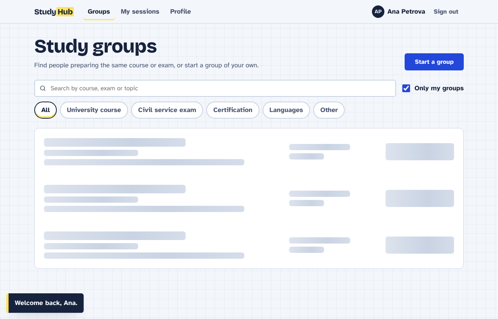
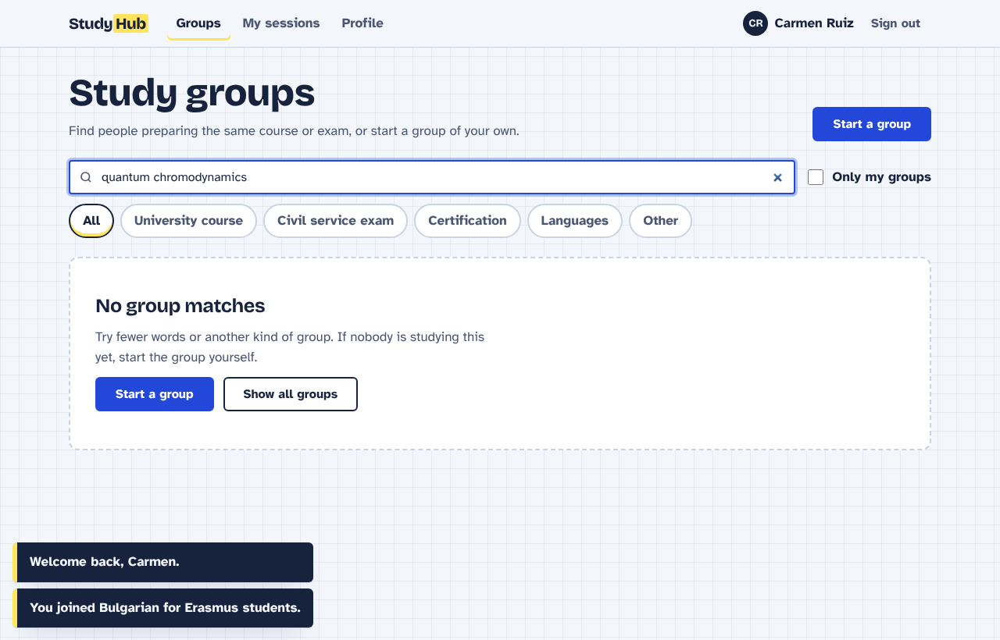
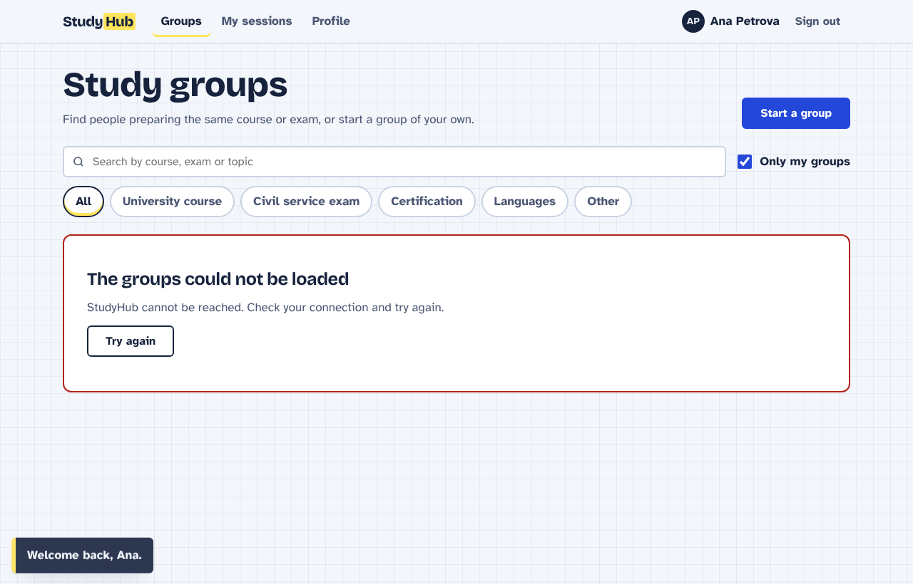
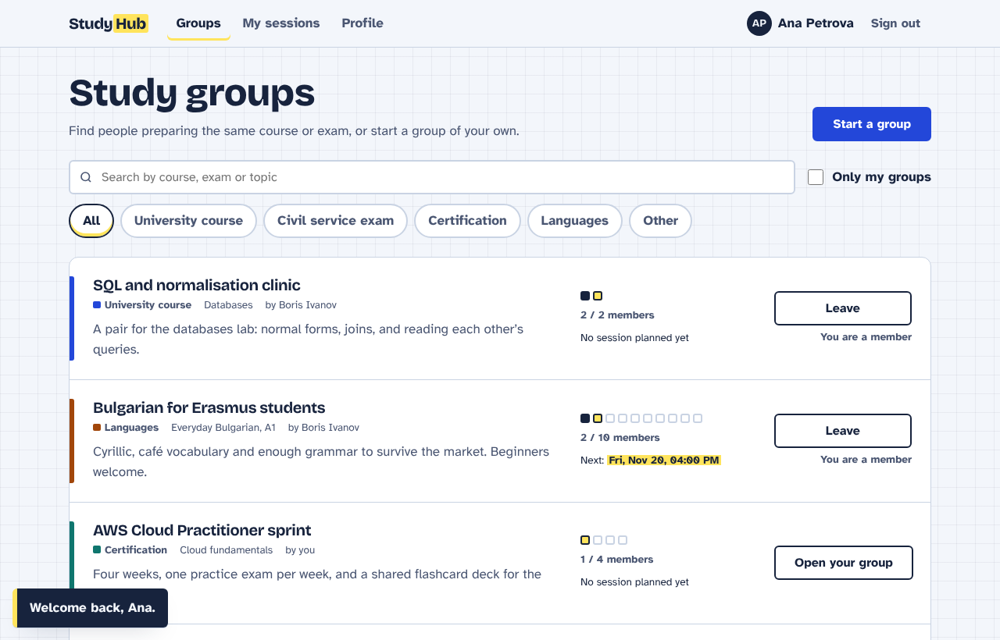
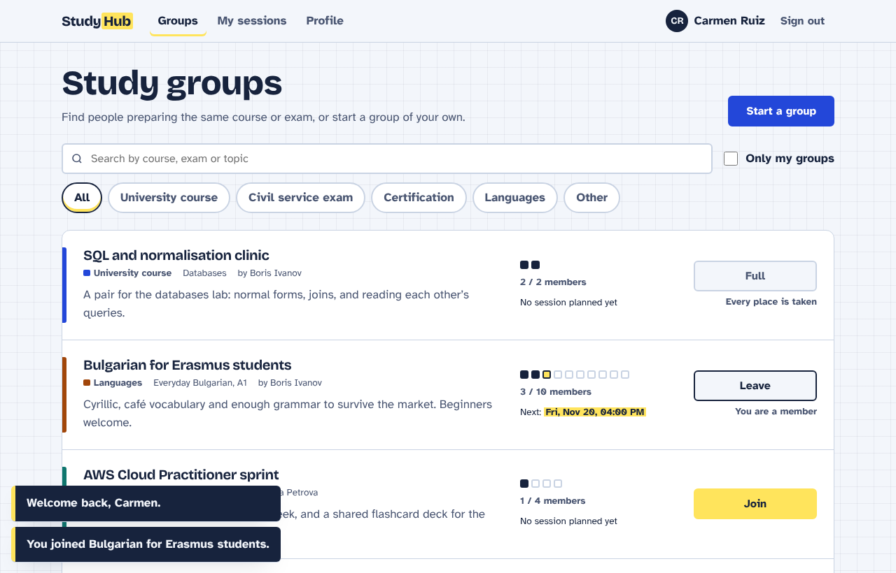

The agenda suggestion thinking and falling back:

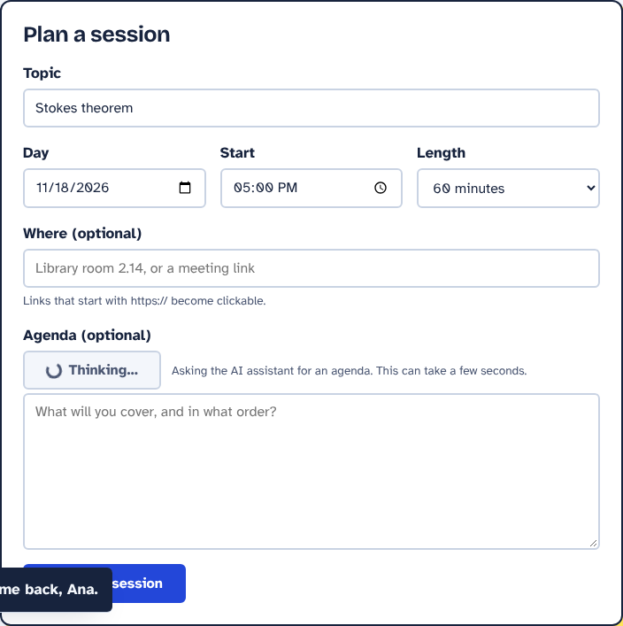
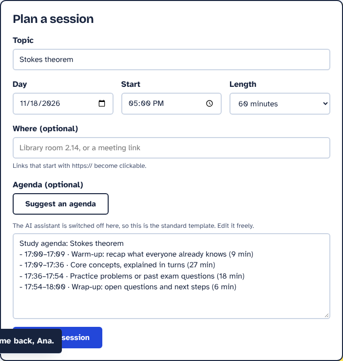

Layouts, focus and dark mode:

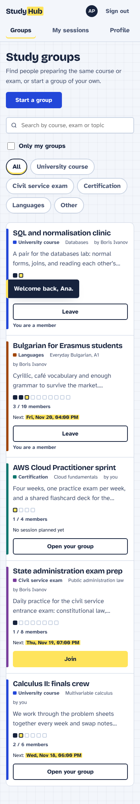
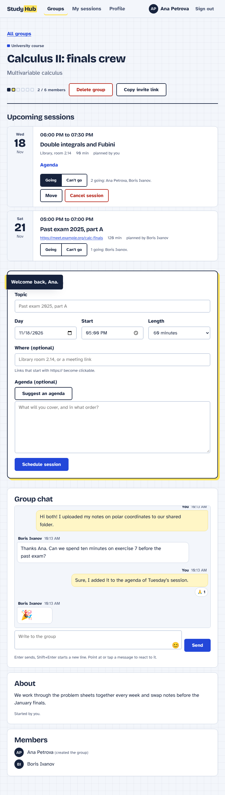
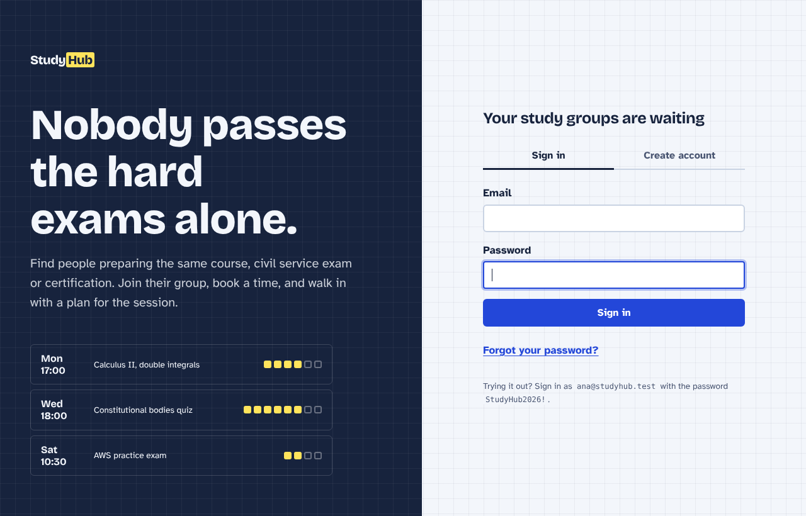
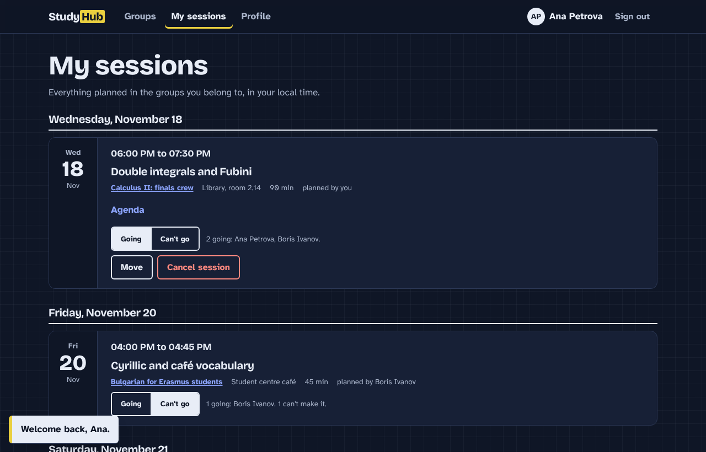
